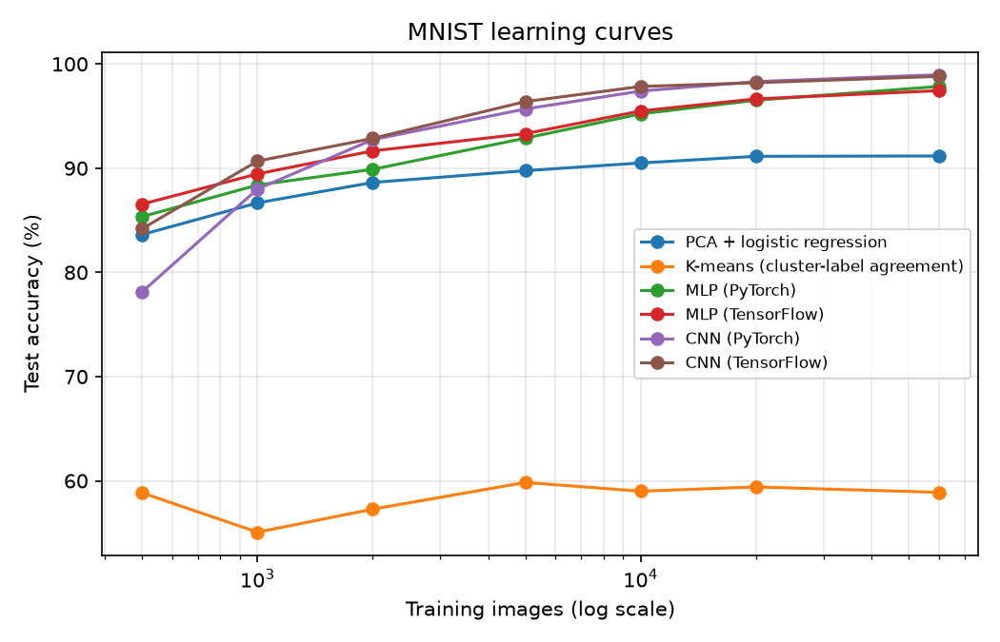
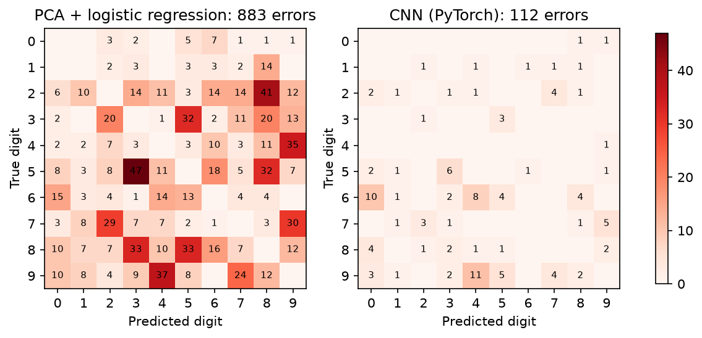

# mnist-ml-pipeline

MNIST digit classification, built entirely on tools from the ML course seminars (PCA, logistic regression, clustering, and a perceptron/neural network), then the same problem re-solved with a PyTorch model and a TensorFlow model side by side.

The point isn't the dataset (MNIST is the "hello world" of ML for a reason); it's having one problem worked all the way from methods I already understand up to two deep learning frameworks, so I can explain every step of it, not just the last one.

## What's actually going on, stage by stage

1. **PCA + logistic regression** (`src/baseline_models.py`): same idea as the eigenfaces project and the dimension-reduction/logistic-regression seminars. 28x28 pixels is 784 raw features, most of it redundant, so PCA finds the directions of highest variance across digit images first, and logistic regression classifies in that reduced space. This is the sanity-check baseline everything else has to beat.
2. **K-means clustering** (`src/baseline_models.py`): an unsupervised pass. Does k=10 clustering on the PCA-reduced pixels roughly line up with the true digit labels, without ever being told what a "3" looks like? A cheap way to see how separable the classes are before any supervised model gets involved.
3. **Perceptron / MLP** (`src/mlp_torch.py`, `src/mlp_tf.py`): the direct extension of `perceptron.ipynb`. Instead of one linear decision boundary, stack a couple of layers with a nonlinearity between them so the model can separate classes that aren't linearly separable in pixel space. Implemented once in PyTorch and once in TensorFlow/Keras with the same architecture, so the two frameworks are directly comparable line-for-line.
4. **CNN** (`src/cnn_torch.py`, `src/cnn_tf.py`): the MLP treats the image as a flat vector and throws away the fact that nearby pixels are related; a convolutional layer uses that structure instead by sliding small learned filters over the image. Same comparison, PyTorch vs. TensorFlow.
5. **Training/eval**: `src/train.py` is a CLI that runs any of the above on the same train/test split and reports accuracy + a confusion matrix, so all five approaches are compared on equal footing.

## Setup

```bash
python -m venv .venv
.venv\Scripts\activate   # Windows
pip install -r requirements.txt
```

## Usage

```bash
# Classical baselines (PCA+logreg, k-means)
python -m src.train --model logreg
python -m src.train --model kmeans

# Perceptron / MLP
python -m src.train --model mlp_torch --epochs 15
python -m src.train --model mlp_tf --epochs 15

# CNN
python -m src.train --model cnn_torch --epochs 10
python -m src.train --model cnn_tf --epochs 10

# Learning curve for all models (saved to results/)
python -m src.learning_curve

# Where PCA + logreg goes wrong vs. the CNN (saved to results/)
python -m src.compare_errors
```

Every run is seeded (`--seed`, default 0), so rerunning a command gives the same numbers. Run the test suite with `python -m pytest`.

MNIST downloads automatically on first run (via `torchvision`/`tensorflow`, whichever the chosen model needs).

## Repo structure

```
src/
  data.py            # MNIST loading, shared train/test split
  baseline_models.py  # PCA + logistic regression, k-means
  mlp_torch.py        # perceptron/MLP in PyTorch
  mlp_tf.py           # perceptron/MLP in TensorFlow/Keras
  cnn_torch.py        # small CNN in PyTorch
  cnn_tf.py           # small CNN in TensorFlow/Keras
  train.py            # CLI entry point, shared eval/reporting
  learning_curve.py   # accuracy vs. training-set size for each model
  compare_errors.py   # most frequent confusions, PCA + logreg vs. CNN
results/              # learning-curve and confusion CSVs and plots
notebooks/
  01_eda_pca.ipynb     # digit visualization + PCA scree plot + k-means cluster purity
```

## Results

Full MNIST (60,000 train / 10,000 test), default settings from the Usage section, `--seed 0`, on CPU.

| Model | Test accuracy | Training time |
|---|---|---|
| PCA (50 components) + logistic regression | 91.2% | 17 s |
| K-means, k=10 (cluster-label agreement) | 59.3% | 18 s |
| MLP (PyTorch), 15 epochs | 97.8% | 85 s |
| MLP (TensorFlow), 15 epochs | 97.8% | 68 s |
| CNN (PyTorch), 10 epochs | 98.9% | 249 s |
| CNN (TensorFlow), 10 epochs | 98.7% | 91 s |

50 PCA components keep 82.5% of the pixel variance. The same architecture lands within 0.2 points across PyTorch and TensorFlow, and the CNN cuts the MLP's error roughly in half.

## Learning curve

Each model trained on nested random subsets of the training set (500 to 60,000 images), default settings, `--seed 0`, evaluated on the full test set. Numbers are in [results/learning_curve.csv](results/learning_curve.csv).



- PCA + logistic regression levels off at about 91% from 20,000 images: more data no longer helps, so the linear model on 50 components is likely the limit.
- K-means stays between 55% and 60% whatever the size, since it never uses the labels to fit.
- The CNNs pass the MLPs from about 2,000 images. With 10,000 images they already reach 97.4 to 97.8%, about what the MLPs get with all 60,000.
- With only 500 images the PyTorch CNN is the weakest neural model (78.1%). Epochs are fixed, so small subsets get very few training steps.

The 60,000-image points come from a shuffled copy of the training set, so k-means and the TensorFlow models land a few tenths of a point away from the results table above.

## Where the baseline goes wrong

Error matrices (correct predictions left out) for PCA + logistic regression and the PyTorch CNN, both trained on the full training set with `--seed 0`. The 15 most frequent baseline confusions are in [results/confusions.csv](results/confusions.csv).



| True | Predicted | PCA + logreg | CNN |
|---|---|---|---|
| 5 | 3 | 47 | 6 |
| 2 | 8 | 41 | 1 |
| 9 | 4 | 37 | 11 |
| 4 | 9 | 35 | 1 |
| 8 | 3 | 33 | 2 |
| 8 | 5 | 33 | 1 |
| 5 | 8 | 32 | 0 |
| 3 | 5 | 32 | 3 |
| 7 | 9 | 30 | 5 |
| 7 | 2 | 29 | 3 |

The baseline's 10 most common mistakes add up to 349 errors (out of 883); the CNN makes 33 on the same pairs. As expected, they are mostly 4/9 and the 3/5/8 group. These digits share most of their pixels and differ in small local details (whether the top of a 4 is closed, which loops of an 8 are open), which 50 global PCA components probably blur, while convolution filters look at local strokes. 9 read as 4 is still the CNN's most frequent mistake.

## Next steps

- Try the same pipeline on Fashion-MNIST to see how much of the accuracy gap holds on a harder dataset
